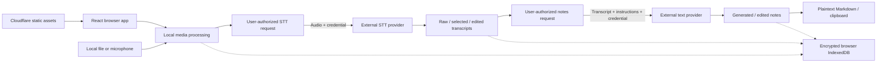

# MoM — Minutes of Meeting

Turn recordings into reviewable transcripts and editable Markdown notes in your browser. MoM supports meetings, lectures and personal voice memos, with your choice of AI provider, input languages and output structure.

**[Open MoM](https://mom.korgeek.workers.dev/)** · [Documentation](docs/README.md) · [Security and encryption](docs/security-and-encryption.md) · [Remaining work](docs/TODO.md)

**License: [MoM Source Available License 1.0](LICENSE)** · Copyright © 2026 korgeek. Source-available; not an OSI open-source license. This is a test build; implemented behavior and verification limits are described below.

## Using MoM

1. **Prepare audio.** Create or unlock an encrypted local vault. Import a supported file or record your microphone, preview the waveform, and prepare compressed chunks with configurable length and overlap. Preparation runs locally and checks actual encoded bytes against the selected model's limits.
2. **Transcribe and choose results.** Select an STT model, review the destination and transmission scope, then authorize the request. Open chunk transcripts in a dialog, listen to their audio, retry with another model and choose which saved result to use. Bulk transcription lets you skip completed chunks or transcribe everything again. Earlier responses and edited versions remain available.
3. **Generate and edit notes.** Choose the output language, sections, instructions, output budget and text model. MoM reuses the selected transcript; changing these settings does not repeat STT. Review and edit the generated Markdown, download `.md` or copy it to the clipboard. Optional two-model comparison preserves each result separately.

Planned audio overlap is included with source ranges in the notes request so the model can reconcile repeated or differently transcribed boundary speech. Normal overlap does not require manual approval at every chunk. Actual missing audio ranges remain disclosed, and material ambiguity must remain qualified rather than being invented away.

Settings keeps API credentials separate from the unified STT/LLM model list. Presets fill configuration; they do not establish account access, model availability or inference quality. OpenRouter routing/privacy policy belongs to the credential and applies to linked models. An authentication check does not prove that a model can execute under that policy. A recorded policy rejection blocks repeats of the same model/settings for that memo. Choose another model or explicitly review the shared credential policy before sending again. Saving a policy never resends audio; the next request needs fresh consent. App settings cannot override ZDR enforced by an OpenRouter account or guardrail.

Usage summaries and expandable request details distinguish retained responses, failures and unknown outcomes. Unknown cost is not zero, and cancelling or retrying a request can still incur provider charges. Storage controls distinguish deleting audio copies from deleting a whole memo and its associated local work.

## Data and architecture



Cloudflare hosts the frontend. MoM has no user accounts, meeting-data server, application database or AI proxy. The browser calls the selected OpenAI, OpenRouter or explicitly configured compatible endpoint directly. Model discovery and authentication checks also contact providers; OpenRouter may route inference to a downstream provider. External retention, routing and billing are separate from local encryption. Paid inference has no automatic app retry or fallback.

The [hosting configuration](wrangler.json) enables persisted Workers invocation logs at full sampling; traces and source maps are disabled. This does not add browser meeting-data telemetry or establish that static-asset delivery generated an invocation log.

The frontend uses React, TypeScript and Vite; Web Crypto, IndexedDB and Web Locks; bounded media Workers and AudioWorklet recording; MP4Box demuxing; browser AAC decoding; and WASM MP3 codecs. Versions are pinned in [package-lock.json](package-lock.json). Main entry points are [controller.tsx](src/react-app/controller.tsx), [media/prepare.ts](src/react-app/media/prepare.ts), [vault/session.ts](src/react-app/vault/session.ts) and [domain/pipeline.ts](src/react-app/domain/pipeline.ts).

## Privacy and locking

Retained audio, transcripts, notes, sensitive metadata and saved provider keys are encrypted in the browser. Encrypted key persistence is the default; session-only keys are available. Enter credentials through the app UI. Original files, plaintext exports and data received by providers are outside this local protection.

New vaults require a passphrase of at least 15 characters; existing vaults retain their previous passphrase compatibility. The app warns after three failed authentication attempts and deletes the local vault after five; deletion is irreversible, and a damaged vault header can also cause authentication failures. This local limit does not prevent offline guesses against a copied vault. See [Security and encryption](docs/security-and-encryption.md#passphrase-rules-and-loss) for the rules and limits.

**Standard** screen locking removes sensitive content from the interface, stops playback and blocks new work while already authorized work can finish. Key/data references are released after the final save. **Strict** locking interrupts work at screen-lock/hidden-page boundaries and retains completed saved work. A failed final save retains the references needed for recovery behind the lock gate; it is not reported as a completed key release.

See [Security and encryption](docs/security-and-encryption.md) for encryption/KDF parameters, ownership between tabs, late responses, save failures and recovery limits. Browser/OS memory zeroization is not guaranteed. Losing the vault passphrase cannot be repaired by resetting the vault; reset deletes local data. Markdown export is not a full vault backup or device transfer.

## Run locally

Use Node.js compatible with the engines in the pinned dependency tree, npm and desktop Chrome. The app requires HTTPS or localhost, Web Crypto, IndexedDB, Web Locks, module Workers and WebAssembly. Microphone recording also requires native permission and AudioWorklet support; M4A preparation requires browser-native AAC decoding.

```sh
npm ci
npm run dev -- --host 127.0.0.1
```

Open the localhost URL printed by Vite and create a vault. Audio preparation needs no provider key. Transcription and notes require your credentials and explicit transmission authorization in the UI. There is no API-key `.env` setup: keep secrets out of source, Git, `VITE_` variables, chat, logs and generated artifacts.

## Check and release changes

Choose tests from the Git diff and directly affected callers, data flows and UI states. Preserve relevant data-loss and security coverage; run full suites only when explicitly requested. For example, a vault/lock change may need:

```sh
git diff --name-only
npm run test:unit -- tests/screen-state.spec.ts tests/lock.spec.ts tests/vault.spec.ts
npm run build
npm run test:e2e -- lock.spec.ts -g 'one unlocked tab|late response'
```

`npm run build` typechecks and builds the app. `npm run test:secret` scans owned source and public build artifacts. Playwright uses a separate visible, sandboxed Chrome window against a local production preview, with synthetic media and intercepted provider responses. It needs installed Chrome and a desktop display. Fixture setup is documented in [tests/fixtures/media](tests/fixtures/media/README.md).

A push to `main` triggers the configured Cloudflare build/deployment. Release only a coherent change after its relevant checks pass. Match the deployed revision and active version, then smoke-check the affected public behavior. Deployment metadata alone does not establish public-origin reachability or a passing UI check. See [verification records](docs/README.md#검증과-배포-기록) for the conditions and limits of individual releases.

## Support and verification limits

| Area | Scope |
| --- | --- |
| Audio | MP3, PCM16 WAV and supported single-track AAC-LC M4A input; prepared output is 16 kHz mono MP3. Actual format, duration and byte limits depend on the selected model profile. |
| Preview | Saved audio supplies its waveform automatically. Restored whole-source playback is bounded to 64 MiB; larger retained sources use waveform navigation and available prepared chunks for playback. |
| Local evidence | Scoped unit/controller/UI tests and headed Chrome scenarios use synthetic audio and intercepted responses. Desktop/mobile viewports have been rendered; viewport tests do not establish physical-device behavior. |
| External validation | User-reported successes are observations, not a repeatable qualification of every provider. Authenticated multilingual STT/notes quality, account-specific CORS/routing/retention and final billing still need controlled verification. |
| Other limits | Physical mobile/background behavior, OS suspension, real quota/eviction and a comprehensive independent security assessment remain unverified. Known test debt is tracked in [TODO](docs/TODO.md). |
| Not implemented | Full encrypted vault backup/restore, device transfer, reliable user-facing recovery of interrupted recordings and hierarchical notes generation. |

## Authorship and license

**Built by korgeek, together with Sam Kim (dots) and Codex.**

korgeek owns product direction, goals, design and final interaction, privacy, security and release decisions. Sam Kim (dots) is an AI assistant supporting requirements, task coordination and verification review. Codex agents implement, test and review code. This describes the collaboration; it does not claim that every line was written manually or that AI systems are legal coauthors or copyright owners.

MoM-owned software uses the **[MoM Source Available License 1.0](LICENSE)**, effective **2026-10-19**. The Korean text is authoritative; this English description is a summary. [Identical distributed terms](public/licenses/MoM-SOURCE-AVAILABLE-LICENSE.txt) are linked from the app.

Personal and internal business meeting use, internal modifications/installations, and source inspection, building, testing and security review are permitted without a license fee. Paid security auditing is permitted. Redistributing modified MoM software, incorporating its protected code into another product, or offering its functionality to external customers requires separate written permission under the full terms, whether the external product/service is free or paid. Meeting inputs and outputs are outside this software license and can be shared according to the rights you hold in them. The full terms also govern verification copies, quotations and platform forks.

**LGPL and existing recipient rights take priority over conflicting restrictions.** The [existing recipient permission](public/licenses/MoM-OBJECT-PERMISSION.txt) preserves own-use modification and reverse engineering for debugging those changes. Applicable library modification, replacement/relinking and source/object-material rights remain intact. The separate [helper MIT license](public/licenses/MoM-CODEC-HELPERS-MIT.txt) covers only [relink-decoder.mjs](public/sources/codecs/relink-decoder.mjs) and [REBUILD-MP3.sh](public/sources/codecs/REBUILD-MP3.sh), not the entire app.

Third-party components retain their own terms. Preserve their notices and applicable codec source/relink and font reserved-name conditions. Applying MoM's license does not change repository visibility, publish private references or meeting data, or restrict earlier grants.

- [Third-party notices](public/THIRD_PARTY_NOTICES.txt) and [runtime JavaScript notices](public/licenses/runtime-JS-NOTICES.txt)
- [Codec source manifest](public/sources/codecs/SOURCE_MANIFEST.json), [codec rebuild/replacement](public/sources/codecs/REBUILD.md) and [distribution source scope](public/sources/REBUILD.md)
- [MP4Box license](public/licenses/runtime-mp4box-2.4.1-LICENSE.txt)
- [Font provenance](public/fonts/README.md), [font notices](public/licenses/reference-font-NOTICES.txt), [Pretendard OFL](public/licenses/Pretendard-OFL.txt) and [IBM Plex OFL](public/licenses/IBM-Plex-OFL.txt)
