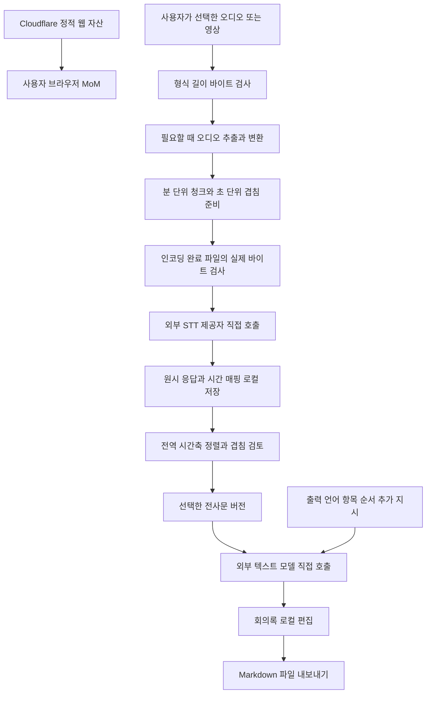

# MoM 처리 구조와 데이터 설계

[문서 인덱스](README.md) · [제품 요구사항](01-product-requirements.md) · 기록 기준일 2026-09-30

이 문서의 구성요소, 상태명과 데이터 필드는 **제안 PROPOSALS**다. 로컬 준비와 외부 AI 호출을 구분하고, 원시 전사·병합 전사·사용자 수정·생성 문서가 서로 덮어쓰지 않는 구조를 제시한다. 실제 구현 코드나 승인된 최종 스키마는 아니다.

## 2026-10-17 준비 초기화와 처리 메타데이터

`MeetingProject.processingArchives?`는 명시적으로 초기화한 호출의 식별자·실제 상태/시각·모델/경로·측정 사용량/비용과 청크 시간 범위만 암호화해 보존한다. 원시 응답, 발화/정리 본문과 수정본, 제공사 오류 본문은 보존하지 않는다. `aggregateProjectUsage`는 현재 세대만 계산하고 `projectHistory`가 보존한 이전 메타데이터를 합쳐 처리 기록에 표시한다. 오래된 자료에 없는 시각/비용/제공사를 생성하지 않는다.

`planPreparationReset`은 원본 보관 및 실행 상태를 확인하고 설정/소유 저장 버전과 단회 토큰을 묶는다. `resetPreparation`은 원본 블록을 제한된 버퍼로 인증한 뒤 소유 청크 레코드 삭제와 프로젝트/카탈로그 교체를 한 IDB transaction에 넣는다. 실패하면 기존 상태를 유지하며 잠금/취소/오래된 계획은 실행되지 않는다. 삭제 레코드 표식으로 오래된 pending snapshot의 파일 재생성을 막는다. controller가 완료된 변경을 먼저 저장하고, 초기화가 커밋된 후에만 원본으로 새 청크를 만든다. 새 인코딩 실패 시 원본/처리 메타데이터는 남고 재준비를 다시 할 수 있다. STT/LLM 호출은 별도 확인으로만 실행한다. [검증 기록](superpowers/evidence/2026-10-17-history-preparation-reset/README.md).

## 2026-10-17 구현된 입력 설정 보완

아래 초기 스키마 제안과 별개로, 현재 구현의 `AudioOptions.transcriptionHints?`는 메모별 `{ terms, context }`를 암호화된 프로젝트에 저장한다. `STTBatch.transcriptionHints?`는 새 요청 당시 입력을 고정하고, pipeline은 이를 `STTRequest`에 전달한다. 기존 묶음의 필드 부재는 그대로 보존한다. 준비 기본값 복원은 전사 힌트를 삭제하지 않는다. 용어·맥락의 크기와 제어 문자를 저장/전송 경계에서 검사한다.

`MinutesSettings.outputTokens?`는 모델에 설정된 한도 내에서 메모별 생성 예산을 지정한다. 생략하면 기존 모델/경로 기본값을 사용한다. 양의 정수/상한을 저장·요청 경계에서 검사하고, 전송 전 적합성·동의 서명·실제 요청의 token 필드와 새 비교에 반영한다. 기존 비교는 고정한 예산을 유지한다. 출력 언어 선택 목록은 기존 `SelectionLists.languages`를 재사용하며 임의 입력과 앱 언어 모드를 보존한다. [변경 검증](superpowers/evidence/2026-10-17-input-hints-notes-layout/README.md).

**2026-10-19 출력 상한과 기본 분량 분리:** 등록 모델의 `llm.maxTokens`는 출력 상한이다. 메모별 `outputTokens`가 없으면 4,096과 설정/보존된 카탈로그 출력 상한 중 작은 값을 기본 요청으로 사용한다. 미리보기·모델 테스트·새 비교·실제 요청에 같은 기본값을 적용하며, 사용자가 선택한 8K/16K/직접 입력은 허용 한도 안에서 그대로 보낸다. 기존 모델 설정을 자동 변경하지 않고, 일치하는 예시 모델의 상한은 모델 수정에서 출력 한도만 명시 적용할 수 있다. 메모별 분량 초안은 메모 ID로 보관하고 저장된 분량이 바뀌면 재조정해 과거 초안을 복원하지 않는다. [선별 검사와 실제 Chrome 화면](superpowers/evidence/2026-10-19-notes-output-limits/README.md).

## 데이터 흐름



브라우저에서 준비하는 파일과 저장하는 결과가 외부 AI로 나갈 데이터의 출처다. STT 요청에는 선택 청크 오디오를, 회의록 생성 요청에는 전사문과 지시를 보낸다. OpenRouter를 사용하면 실제 추론을 수행하는 하위 제공자가 데이터 경로에 추가된다. 호스팅 Worker가 이 요청들을 중계하는 구조는 현재 기준에 포함하지 않는다.

## 책임 분리

| 영역 | 제안 책임 | 경계 |
| --- | --- | --- |
| 화면과 작업 제어 | 파일 선택, 옵션, 상태·오류·검토 표시 | 화면 갱신에 무거운 전체 디코딩을 묶지 않는다 |
| 로컬 미디어 처리 | 메타데이터 검사, 유효한 청크 생성, 필요 압축 | 외부 추론을 대신하지 않는다 |
| STT 호출 | 모델별 능력 확인, 청크 요청, 응답 검증 | 브라우저 CORS와 실제 인증을 각각 확인한다 |
| 로컬 결과 저장 | 원시 응답, 매핑, 상태, 버전, 백업 | 보관 완료 전에는 저장 완료로 표시하지 않는다 |
| 전사 정리 | 시간 정렬, 겹침 처리, 불확실성 표시 | 정보 없는 화자나 정확한 단어 시간을 만들어내지 않는다 |
| 회의록 생성 | 선택 전사문과 출력 설정으로 텍스트 요청 | 원시 전사를 덮어쓰거나 STT를 반복하지 않는다 |
| 호스팅 | 앱 코드와 정적 자산 제공 | AI 프록시·사용자 자료 서버 저장은 별도 승인 사안이다 |

Web Worker는 미디어 처리로 화면이 멈추는 일을 줄이기 위한 후보다. 처리 장소를 옮겨도 같은 장비의 메모리를 사용한다. 라이브러리·디코더 선택은 [오디오 설계](03-audio-pipeline.md)의 포맷 시험 후 정한다.

## 작업 단위와 버전

하나의 `MeetingProject` 아래에 원본 파일 기록, 청크 계획, STT 실행, 전사 버전, 회의록 실행을 연결하는 안을 권장한다. 파일명만으로 작업을 식별하지 않는다. 같은 이름의 다른 녹음과 같은 오디오의 다른 인코딩을 구분할 로컬 식별자가 필요하다.

전사 버전 A를 고쳐 B를 만들면 A에서 생성한 회의록은 남기고 B를 기준으로 다시 생성할 수 있다. 화면에는 어떤 전사 버전으로 만든 회의록인지 표시한다. 사람이 회의록을 편집한 결과도 생성 원문과 분리해 보관하는 안이다. 텍스트를 수정했다고 STT가 성공한 것으로 상태를 바꾸지 않는다.

## 데이터 스키마 제안

| 개체 | 핵심 필드 | 보관 이유 |
| --- | --- | --- |
| MeetingProject | id, title, createdAt, updatedAt, schemaVersion, status | 목록·복구·버전 호환을 위한 기준 |
| SourceAsset | id, fileName, bytes, container, codec, durationMs, channels, sampleRate, fingerprint, localReference | 원본 식별과 재연결, 전처리 비교 |
| ChunkPlan | id, sourceId, targetDurationMs, overlapMs, ranges, preprocessingSettings | 동일 조건 재현과 시간 매핑 |
| PreparedChunk | id, planId, index, sourceStartMs, sourceEndMs, encodedBytes, mimeType, codec, localReference | 전송 파일과 원본 구간 연결 |
| TranscriptionRun | id, chunkId, provider, model, settings, attempt, startedAt, endedAt, requestId, outcome, usage | 모델·시도별 경위와 비용 추적 |
| RawTranscript | id, runId, rawResponse, returnedText, returnedSegments, timingCapability, speakerCapability | 제공자 반환값을 수정 없이 보존 |
| TranscriptVersion | id, parentVersionId, sourceRawIds, segments, edits, mergeNotes, status | 병합과 사람 수정의 근거 |
| BoundaryIssue | id, sourceRawIds, sourceRangeMs, alternatives, selectedAlternative, resolution | 경계에서 삭제될 수 있는 정보 보호 |
| MinutesRun | id, transcriptVersionId, provider, requestedModel, actualProvider, settings, outputLanguage, sections, instructionVersion, output, usage | 동일 입력 비교와 생성 경위 |
| MinutesRevision | id, runId, parentRevisionId, markdown, editedAt | 사용자 편집과 생성 원문 분리 |
| Checkpoint | projectId, committedResultIds, pendingChunkIds, lastSuccessfulStage, savedAt | 중단 후 재시작 판단 |

이는 필드 후보 목록이다. `null` 또는 미제공 상태를 허용해야 한다. 예를 들어 실제 제공자, 요청 ID, 비용, 단어 시간, 화자가 API에서 제공되지 않았으면 빈값에 추정치를 사실처럼 넣지 않는다. 키와 Authorization 헤더는 이 개체에 넣지 않는다.

시간 필드는 내부에서 밀리초 정수 등 하나의 단위로 통일하는 안이다. 외부 모델이 반환한 초 단위 값은 원시 응답에 남기고 정규화 변환을 따로 기록한다. UTC 실행 시각과 녹음 상대 시간은 서로 다른 필드로 관리한다.

### 설명용 예시

```json
{
  "schemaVersion": 1,
  "projectId": "local-meeting-example",
  "chunk": {
    "index": 2,
    "sourceStartMs": 590000,
    "sourceEndMs": 1190000,
    "overlapWithPreviousMs": 10000,
    "encodedBytes": null
  },
  "transcript": {
    "timingCapability": "chunk-only",
    "speakerCapability": "not-provided",
    "rawResponseId": null,
    "reviewStatus": "pending"
  },
  "usage": {
    "measurementType": "not-available",
    "amount": null,
    "currency": null
  }
}
```

이 예시는 10분 구간과 10초 겹침을 설명할 뿐 실제 처리 결과가 아니다. 인덱스는 화면에서 1부터 시작하는 예로 썼으며 최종 규칙은 구현 계획에서 정한다.

## 단계 상태 제안

프로젝트 전체 상태 하나로 모든 청크를 표현하면 일부 성공과 저장 실패가 보이지 않는다. 작업 단계, 청크, 실행 시도를 따로 관리하는 안을 제안한다.

| 대상 | 상태 후보 | 의미 |
| --- | --- | --- |
| 프로젝트 | imported, preparing, transcribing, needs-review, generating, completed, partial-failure, paused | 사용자가 다음 행동을 판단하는 요약 상태 |
| 준비 작업 | pending, inspecting, extracting, encoding, validating, ready, failed, cancelled | 로컬 미디어 단계 |
| 청크 STT | queued, requesting, response-received, saving, saved, failed, cancelled, outcome-unknown | 전송·응답·저장과 불확실한 결과를 구분 |
| 전사 버전 | incomplete, merged, needs-review, reviewed | 누락과 경계 확인 상태 |
| 회의록 실행 | pending, requesting, response-received, saving, saved, failed, cancelled, outcome-unknown | 텍스트 생성도 별도 저장 경계를 둔다 |

`outcome-unknown`은 응답 전 연결이 끊겨 제공자가 처리했는지 모르는 상태다. 이를 단순 실패로 표시하고 자동 재전송하면 중복 비용이 생길 수 있다. 제공자의 조회·중복 방지 능력이 확인되기 전에는 성공이나 무비용 재시도를 약속하지 않는다.

## 저장과 재개 순서

1. 원본 메타데이터와 청크 계획을 먼저 저장한다. 원본 파일을 보관하지 않는 설정이면 재연결이 필요함을 남긴다.
2. 한 청크의 응답을 받으면 원시 반환값과 실행 정보를 로컬에 기록한다.
3. 읽기 확인 또는 트랜잭션 완료 후 해당 청크를 `saved`로 전환하고 체크포인트를 갱신한다.
4. 다음 실행은 저장된 완료 결과를 재사용하고 미완료·명시 재시도 대상만 선택한다.
5. 병합 전사는 원시 결과 목록을 참조해 새 버전으로 만든다. 사람이 수정하면 새 전사 버전을 기록한다.
6. 회의록 실행은 선택 전사 버전과 출력 설정을 고정해 기록한다.

IndexedDB와 OPFS가 로컬 저장 후보다. 어디에 Blob과 메타데이터를 나눌지는 미결정이며, 여러 저장소를 함께 사용하면 일관성·정리 순서도 시험해야 한다. 브라우저 저장은 영구 백업을 대신하지 않는다. [저장·개인정보 문서](06-privacy-and-local-storage.md)를 함께 읽는다.

새로 확정한 요구에 따라 위 스키마의 민감한 값은 저장 전에 암호화해야 한다. 원시 API 응답·제목·파일명·상태 상세·실행 설정·사용량도 회의 정보를 드러낼 수 있어 암호화 대상이다. 공개 저장 영역은 복호화에 필요한 salt·KDF 파라미터·버전 등으로 제한하는 설계가 필요하다. 잠금 상태에서는 전사·회의록·제목을 DOM과 메모리 참조에서 제거하고, 작업을 안전하게 정지하는 정책을 정한다. 실제 암호화 구성은 별도 검토 전의 제안이다.

## 취소와 복구

취소는 새 청크 예약을 멈추고 가능한 요청을 중단하는 행동이다. 서버에서 이미 시작한 추론과 비용까지 되돌린다고 표시하지 않는다. 받은 완료 결과를 먼저 보존하는 방향을 제안한다. 미디어 처리 취소 시 임시 자원을 정리하되, 이미 저장한 원시 결과를 삭제하지 않는다.

새로고침 후 세션 메모리의 키가 없어졌으면 재입력을 요청하고 작업 상태는 별도로 복원하는 안이다. 원본이나 준비 청크가 없으면 필요한 파일을 다시 선택하게 한다. 원본 식별을 확인하기 전에는 같은 이름의 파일을 자동 연결하지 않는다. 취소·재개·새로고침 복구는 아직 제품에서 검증하지 않았다.

## 구성 변경에 따른 재실행 범위

| 변경 | 다시 필요한 작업 | 재사용할 수 있는 결과 |
| --- | --- | --- |
| 출력 언어·항목·순서·추가 지시·텍스트 모델 | 회의록 생성 | 선택 전사 버전과 오디오 준비 결과 |
| 사람이 전사 오류 수정 | 수정 전사 기준 회의록 생성 | 원시 STT 응답과 청크 |
| STT 모델·인식 관련 설정 | 선택한 청크의 새 STT 실행 | 적합한 준비 청크와 기존 STT 기록 |
| 코덱·비트레이트·채널·청크 계획 | 새 청크 준비와 필요한 새 STT | 원본과 이전 실행 기록 |
| 제목이나 로컬 표시 이름 | 메타데이터 갱신 | 모든 처리 결과 |

최초 구현에서는 이 관계를 이용해 완료 결과를 불필요하게 재전송하지 않는지 검증한다. 최종 기술 선택보다 먼저 확인해야 할 구조상의 기준이다.
