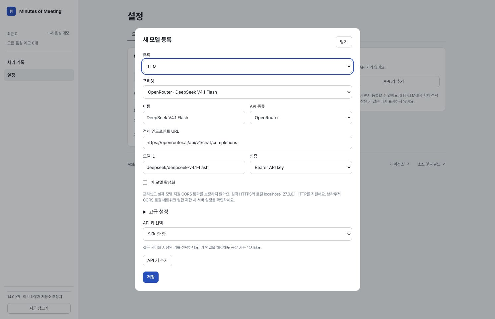
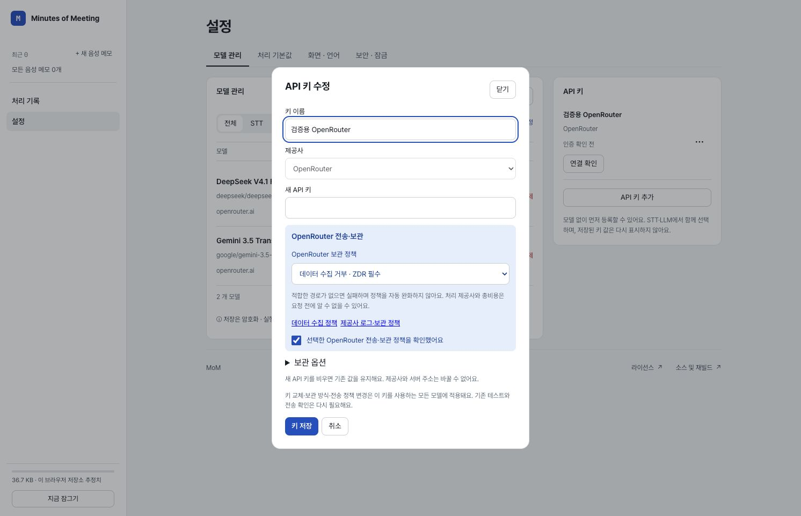

# API 정책 이동과 OpenRouter 모델 프리셋

2026-10-18, 시작 HEAD `147f187d43a62cdc81355cdc360cf2c811e8ca87`. 작업 전 변경·미추적 파일이 없었고 로컬 `main`과 기록된 `origin/main`은 같은 SHA였다. 원격 fetch/pull은 하지 않았다. 사용자는 문서 전용 지침과 이번 변경 범위를 확인한 뒤 **실제 앱 코드 수정**을 승인했다. 이번 기록은 로컬 검증이며 운영 배포 완료 기록이 아니다.

**후속 배포:** 사용자가 검증 후 커밋·배포를 명시적으로 승인했다. 동일 제품 커밋 `bcb9d7a`의 배포·운영 자산·변경 화면 확인 결과는 [배포 기록](release/README.md)을 따른다. 아래 로컬 검증 당시의 범위와 미실행 기록은 보존한다.

## 반영한 동작

- OpenRouter 전송·보관 정책, 두 정책 링크와 확인 체크를 API 키 추가·수정으로 이동했다. 정책 변경은 확인을 해제하며, 확인 전에는 API 폼을 저장할 수 없다. 이미 저장한 정책 확인은 같은 API를 쓰는 새 모델에서 반복하지 않는다.
- 정책은 비밀값을 포함하지 않는 credential 메타데이터에 추가하며 기존 암호화 catalog에 저장한다. 같은 API를 참조하는 STT·LLM과 폼의 요청 미리보기는 이 값을 적용한다. 정책 변경은 모델 revision/signature와 기존 테스트를 갱신하고 기존 controller의 전송 확인 무효화를 재사용한다. 완료 결과·이전 요청 스냅샷은 다시 쓰지 않는다.
- 기존 credential에 새 필드가 없으면 기존 모델별 정책과 확인을 보존한다. API 정책을 처음 설정하면 새 정책의 확인이 필요하다. 표준 보관 허용에서 ZDR 필수로 바꿀 때 이전 STT의 `routerRequireZdr:false`가 엄격한 새 정책을 덮어쓰지 않도록 함께 적용한다. 저장 실패 시 정책·모델 revision·키를 함께 보존한다.
- 새 모델 폼은 `종류 → 프리셋 → 이름/API 종류/주소/모델 ID/인증` 순서다. 프리셋 표시에 OpenRouter/OpenAI/호환 API를 붙이고 선택 상태를 유지한다. 이름·전체 엔드포인트·모델 ID·Bearer/인증 없음과 기존 단계별 설정을 채운다. 원문 API 키는 프리셋에 포함하지 않고 같은 origin의 API 등록을 별도 선택한다. 새 STT와 LLM의 초기 API는 OpenRouter다.
- 아래 9개 프리셋을 추가했다. STT는 기존 JSON/base64 전사 전송을, LLM은 기존 단일 Chat Completions 요청을 쓴다. 예제의 이미지·동영상 전송이나 후속 대화 기능을 추가하지 않는다. LLM reasoning은 사용자 예제대로 활성화하며 Muse는 `effort:medium`을 쓴다. 초기 출력 예산은 4,096 tokens다.

## 공식 자료 확인

인증 없는 공개 목록 `GET https://openrouter.ai/api/v1/models` 및 `GET https://openrouter.ai/api/v1/models?output_modalities=transcription`에서 9개의 정확한 ID와 입력/출력 종류를 확인했다. LLM 문맥 한도는 이 목록의 공개 값이며 DeepSeek/GLM/Muse는 1,048,576, Haiku는 1,000,000이다. 가격·추론 성공·CORS·정책에 맞는 실제 경로를 검증한 것은 아니다.

| 종류 | 추가한 모델 ID | 공식 페이지 |
| --- | --- | --- |
| STT | `openai/whisper-1` | [Whisper 1](https://openrouter.ai/openai/whisper-1/api) |
| STT | `x-ai/grok-stt-1.0` | [Grok STT 1.0](https://openrouter.ai/x-ai/grok-stt-1.0/api) |
| STT | `qwen/qwen3-asr-1.7b` | [Qwen3 ASR 1.7B](https://openrouter.ai/qwen/qwen3-asr-1.7b/api) |
| STT | `mistralai/voxtral-mini-transcribe` | [Voxtral Mini Transcribe](https://openrouter.ai/mistralai/voxtral-mini-transcribe/api) |
| STT | `google/gemini-3.5-transcribe` | [Gemini 3.5 Transcribe](https://openrouter.ai/google/gemini-3.5-transcribe/providers) |
| LLM | `deepseek/deepseek-v4.1-flash` | [DeepSeek V4.1 Flash](https://openrouter.ai/deepseek/deepseek-v4.1-flash/api) |
| LLM | `z-ai/glm-5.3-flash` | [GLM 5.3 Flash](https://openrouter.ai/z-ai/glm-5.3-flash/api) |
| LLM | `meta/muse-spark-1.3-contributor` | [Muse Spark 1.3 Contributor](https://openrouter.ai/meta/muse-spark-1.3-contributor) |
| LLM | `anthropic/claude-haiku-5.5` | [Claude Haiku 5.5](https://openrouter.ai/anthropic/claude-haiku-5.5/api) |

[수집 정책](https://openrouter.ai/docs/guides/privacy/data-collection)과 [제공사 보관 정책](https://openrouter.ai/docs/guides/privacy/provider-logging)을 다시 읽었다. Muse Contributor의 공식 설명에는 입력·출력의 제품 개선 사용 가능성이 있다. 프리셋도 `data_collection:deny`와 선택한 ZDR 정책을 유지하므로 적합한 경로가 없으면 실패할 수 있다. 자동 정책 완화나 다른 모델 대체는 없다. STT의 16,000,000-byte/900-second 설정은 기존 앱의 보수적 상한이며 각 제공사의 지원 보장으로 표시하지 않는다.

## 수행한 검증

검증 전 등록 폼·credential 정책과 직접 영향을 받는 저장/실행 소비자만 검사한다고 안내했다. 전체 스위트는 실행하지 않았다.

| 실제 명령 | 결과·범위 |
| --- | --- |
| `npx vitest run tests/api-credentials.spec.ts tests/api-keys-ui.spec.tsx tests/model-registrations-ui.spec.tsx tests/model-registrations.spec.ts --reporter=dot` | 최종 **49/49 통과**. API 정책 상속·유효성·저장 실패·재로드, 확인 해제, 폼 순서·자동 입력, 9개 실제 요청 body 조립, 비밀값 제외. 최초 테스트에서는 미구현으로 15개 실패를 확인하고 구현 후 통과했다. |
| `npx vitest run tests/model-registrations-ui.spec.tsx -t 'places provider-labelled' --reporter=dot` | 새 LLM 폼의 OpenRouter 기본값 변경 전 OpenAI여서 실패함을 확인. 변경 후 위 49개 실행에서 통과했다. |
| `npx vitest run tests/vault-model-registrations.spec.ts tests/model-registration-migration.spec.ts tests/model-registrations-controller.spec.tsx tests/unified-model-controller.spec.tsx tests/registration-test.spec.ts tests/model-manager-ui.spec.tsx --reporter=dot` | **99/99 통과**. 기존 등록 이전·암호화 저장·키/등록 변경·모델 테스트와 실제 controller의 전사/정리 소비자. 이 결과 이후 변경은 새 모델 폼의 기본 프리셋과 해당 UI/저장 실패 테스트였으므로 이 6개 파일의 동일한 실행 경로를 반복하지 않았다. |
| `npm run typecheck` | 종료 0. |
| `npm run build` | 최종 제품 코드에서 종료 0 (`tsc -b && vite build`). 기존 동적/정적 혼합 import와 500 kB 초과 chunk 경고가 출력됐다. 배포를 실행하지 않았다. |
| `npx eslint src/react-app/providers/model-profiles.ts src/react-app/providers/model-registrations.ts src/react-app/ui/components/ApiKeys.tsx src/react-app/ui/components/ModelRegistrations.tsx src/react-app/vault/store.ts tests/api-credentials.spec.ts tests/api-keys-ui.spec.tsx tests/model-registrations-ui.spec.tsx tests/model-registrations.spec.ts` | 종료 0. 변경한 코드·테스트만 검사. |
| `node scripts/check-public-artifacts.mjs` | 종료 0. 소유 앱 소스·정적 자산·클라이언트 빌드에서 credential 패턴·미허용 제공사 URL·fixture payload·평문 web storage 쓰기 검출 없음. 실제 비밀값을 출력하지 않았다. |
| `git diff --check` | 종료 0. |
| `shasum -a 256 -c /tmp/mom-model-reference.sha256` | 원본 reference 6개 모두 OK. HTML 3개, support.js, thumbnail, 참고 PNG가 변경되지 않았다. |

### 별도 로컬 Chrome

`npm run dev -- --host 127.0.0.1 --port 4186 --strictPort`로 제품 개발 서버를 띄우고 별도 Chrome 검증 세션을 사용했다. 한국어 **1492×961**, document width 1492에서 확인했다. 기존 운영 탭이나 사용자 보관함에 접근하지 않고 이 origin에 새 합성 보관함·가짜 API 키만 만들었다. 연결 확인·추론·음성 전송은 누르지 않았다.

1. 원본 standalone reference의 설정 화면을 실제 렌더링하고 글꼴·색상·카드 배치를 확인했다. 관련 companion HTML·support.js·thumbnail·첨부 이미지도 읽었다. 최신 사용자 요청이 설정의 후속 변경 기준이다.
2. 새 STT 폼에서 제공사 표시, 종류/프리셋/이름 순서와 Whisper ID 자동 입력을 확인했다. LLM 전환 후 DeepSeek 이름·ID·Chat Completions URL·Bearer 인증을 확인했다. 모델 등록에 정책 폼이 없는 상태를 확인했다.
3. 모델 초안에서 API 추가 모달을 열어 정책이 그곳에 나타나는 것을 확인했다. 확인 후 표준 보관으로 바꾸자 체크가 해제되고 저장 버튼이 비활성화됐다. ZDR 필수로 되돌리고 명시 확인 후 합성 키만 로컬 저장했다.
4. 보존된 LLM 초안에서 새 API 참조가 선택된 것을 확인하고 저장했다. 두 번째 Gemini STT도 같은 API를 골라 정책 확인 폼의 반복 없이 저장했다.
5. 새로고침·잠금 해제 후 STT/LLM과 API 목록 복원을 확인했다. API 수정에서 정책과 확인 체크가 보존되고 원문 키 입력은 빈 상태임을 확인했다. 마지막 잠금 후 등록 이름·키 폼이 접근성 트리에서 제거됐다. 캡처된 console warn/error는 0개였다.

## 변경 파일과 한계

제품: `src/react-app/providers/model-profiles.ts`, `src/react-app/providers/model-registrations.ts`, `src/react-app/ui/components/ApiKeys.tsx`, `src/react-app/ui/components/ModelRegistrations.tsx`, `src/react-app/vault/store.ts`.

검사: `tests/api-credentials.spec.ts`, `tests/api-keys-ui.spec.tsx`, `tests/model-registrations-ui.spec.tsx`, `tests/model-registrations.spec.ts`.

문서·증거: `docs/README.md`, `docs/09-decisions-and-roadmap.md`, 이 README와 같은 디렉터리의 JPEG 두 개.

실제 키·유료 추론·음성/노트 품질·제공사별 포맷/장시간 한도·현재 정책의 실제 라우팅·인증 CORS·모바일/영문 렌더링·전체 제품 흐름·운영 배포는 이번 검증에 포함하지 않았다. 프리셋 등록은 실행 성공 보장이 아니다. 푸시·배포 없이 로컬 결과만 남긴다.
