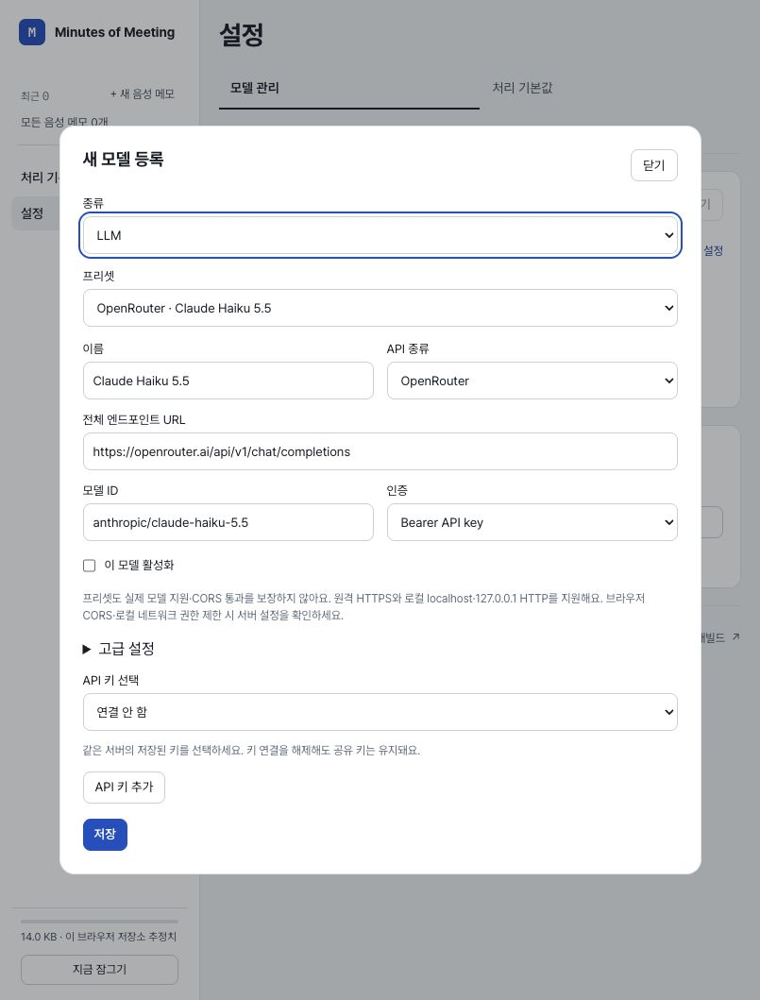
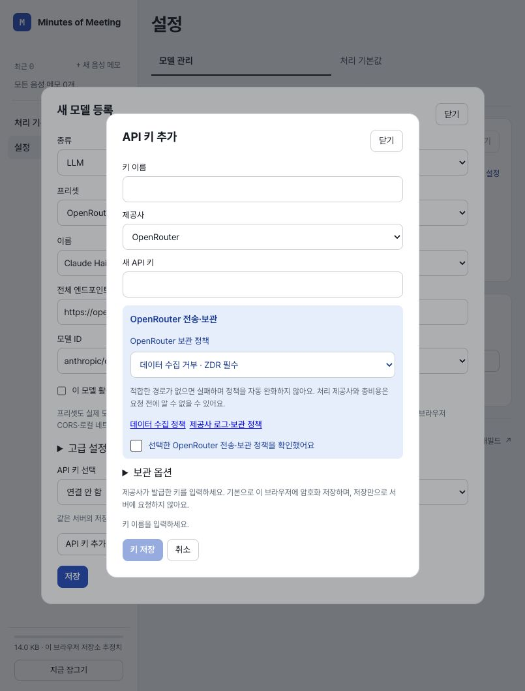

# API 정책·모델 프리셋 배포

2026-10-18. 사용자가 작업 계획을 승인하고 검증 후 커밋·배포까지 요청했다. 제품 변경은 로컬에서 이미 검증·커밋한 `bcb9d7ac890498982e828c3c277f5f784404de03`이다. [기능 변경과 관련 테스트 148개·로컬 Chrome 검증](../README.md)을 재사용했다. 코드·lockfile·도구 버전이 유지됐으며 새 전체 스위트·재설치·불필요한 반복 검사는 하지 않았다.

## 배포 전 확인

- `git status --short`, `git rev-parse HEAD`, `git branch -vv`, `git for-each-ref --format='%(refname) %(objectname)' refs/remotes`: 작업 트리 clean, main은 bcb9d7a이며 기록된 origin/main보다 1개 앞섰다.
- `git ls-remote origin refs/heads/main`: 실제 원격도 예상한 `147f187d43a62cdc81355cdc360cf2c811e8ca87`였다. pull/reset/강제 푸시는 하지 않았다.
- `git diff bcb9d7a HEAD -- src public package.json package-lock.json vite.config.ts wrangler.json`: 차이 없음. 설치된 Vite 7.3.7, Vitest 5.0.3, Wrangler 4.151.1, Cloudflare Vite plugin 1.64.0 확인. 현재 셸 Node는 26.5.0이다. plugin의 package.json을 package export로 조회한 진단 명령은 `ERR_PACKAGE_PATH_NOT_EXPORTED`였고, 설치 패키지의 공개 메타데이터 파일을 읽어 버전을 확인했다. 제품 파일을 바꾸지 않았다.
- `node scripts/check-public-artifacts.mjs`: PASS. 기존 빌드의 앱 소스·공개 자산 검사에서 credential 패턴·평문 web storage·fixture payload 등 검출 없음.
- `WRANGLER_LOG_PATH=/tmp/mom-presets-release-wrangler.log npx wrangler deploy --dry-run --outdir /tmp/mom-presets-release-worker`: PASS. dist/client의 자산 84개, Worker 바인딩 없음. 실제 CLI 직접 배포 대신 승인된 main 자동 배포를 사용했다.
- `git diff --check`: PASS.

## 푸시·Cloudflare

`git push origin main`으로 `147f187..bcb9d7a`를 정상 푸시했다. [GitHub 검사](https://github.com/korgeek/mom/commit/bcb9d7ac890498982e828c3c277f5f784404de03/checks)의 `Workers Builds: mom`은 `completed/success`, 완료 시각은 2026-10-18T02:25:00Z(Asia/Jakarta 09:25)다.

- `gh api repos/korgeek/mom/commits/bcb9d7ac890498982e828c3c277f5f784404de03/check-runs --jq '.check_runs[] | {name,status,conclusion,details_url,completed_at}'`: 위 빌드 성공 확인. build ID `047df863-c5dd-4253-b200-04ad3275174b`.
- `WRANGLER_LOG_PATH=/tmp/mom-presets-release-wrangler.log npx wrangler deployments list --json`: deployment `1682484f-045b-453c-9be1-8d78bfbbb540`, version **`992f9ce1-37ae-46ed-9157-3c86169294df` 100%**, 생성 시각 2026-10-18T02:24:53.396512Z 확인. 계정 이메일·인증 토큰은 기록하지 않았다.

이 기록을 담는 후속 문서 커밋에는 제품 소스·의존성·빌드 설정 변경이 없다. 같은 제품 산출물에 대한 통과 증거를 유지하고 후속 문서 푸시의 검사 상태와 원격 일치만 확인한다.

## 운영 자산 대조

운영 주소는 [Minutes of Meeting](https://mom.korgeek.workers.dev/)이다. 최초 상태 조회 때 빌드는 진행 중이었고 이전 JS를 반환했다. 빌드 성공 뒤 운영 HTML·JS·CSS가 검증된 로컬 빌드와 일치했다.

`curl -fsS --max-time 25 -D /tmp/mom-presets-production-headers.txt https://mom.korgeek.workers.dev/ -o /tmp/mom-presets-production.html`은 HTTP 200이었다. 자산 검증 스크립트의 최초 Python urllib 요청은 HTTP 403이었으며, 정상 작동한 curl을 전송 수단으로 바꾼 `python3 /tmp/mom-presets-verify-release.py`는 PASS였다. 브라우저 보안이나 서비스 정책은 변경하지 않았다. 다음 세 파일의 HTTP 200·MIME·SHA-256을 로컬 파일과 비교했다.

| 자산 | MIME | SHA-256 |
| --- | --- | --- |
| `/` | text/html | `268d9f9e35f26ec614c78f0cfc5f5b4a66c6d9c412a8e192d5b6b2aeb88f718b` |
| `/assets/index-L_aUuTuV.js` | text/javascript | `d9edf99637e43bf5fb06d53d666af4bc9bde2ab026259b01279af63e57ea44f5` |
| `/assets/index-B-X2PIxR.css` | text/css | `81a385b1ca2d4ad0e613bcad0583953b1bfec0b2fb31ab36bfefd2978239dffe` |

HTML 응답의 CSP, COOP, Permissions-Policy, Referrer-Policy, X-Content-Type-Options 5개 헤더도 존재했다. 이번에 변경하지 않은 오디오 Worker/WASM 전체를 다시 내려받거나 전수 비교하지 않았다.

## 운영 화면 스모크

사용자의 기존 Chrome 운영 탭과 분리된, 보이는 앱 내 브라우저에서 진행했다. 첫 화면이 **새 보관함 만들기**임을 확인하고 합성 테스트용 보관함만 만들었다. 실제 사용자 키·음성 메모·보관함에 접근하지 않았고 제공사 연결 확인·STT·LLM 실행도 누르지 않았다.

한국어 **805×1059**(document width 805)에서 다음을 실제 렌더링·조작했다.

1. 새 STT 모델의 `종류 → 프리셋 → 이름` 순서와 추가 STT 5개 선택지를 확인하고 OpenRouter Whisper 1을 선택했다.
2. LLM으로 전환해 추가 LLM 4개와 OpenRouter 기본값을 확인했다. Claude Haiku 5.5 선택 시 이름·모델 ID·전체 Chat Completions URL·Bearer 인증을 확인했다. 모델 폼의 정책 블록은 없었다.
3. 중첩 API 등록을 열어 OpenRouter 정책과 링크가 그곳에 표시됨을 확인했다. 확인 후 정책을 표준 보관으로 바꾸자 체크가 해제됐다. API 원문 키를 입력·저장하지 않고 취소한 뒤 모델 초안 보존을 확인했다.
4. 키가 없는 비활성 모델 등록을 저장하고 새로고침·잠금 해제 후 같은 등록 복원을 확인했다. 마지막으로 보관함을 잠갔다. console warn/error는 0개였다.

최초 보관함 입력 시도는 첫 암호 입력란이 빈 상태여서 생성 버튼이 비활성이었다. 실제 입력 상태를 다시 관찰하고 두 합성 입력을 일치시킨 뒤 생성·재로드 검사를 통과했다. 이 과정에서 제품 코드나 입력 검증을 변경하지 않았다.

## 한계

실제 인증 추론·제공사 CORS/보관 정책의 실행 수용·청구·음성/정리 품질·전체 제품 경로·모바일/영문 행렬은 이번 배포 검사에 포함하지 않았다. 관련 키 없는 계약·로컬 저장 검사와 배포 후 변경 화면 스모크를 구분한다. Muse Contributor도 수집 거부/ZDR에 맞는 경로가 없으면 실패할 수 있으며 정책을 자동 완화하지 않는다.
