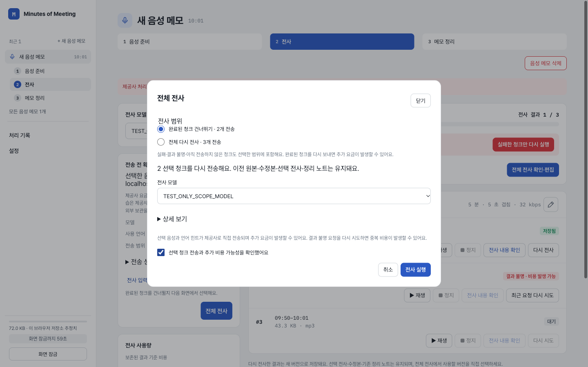
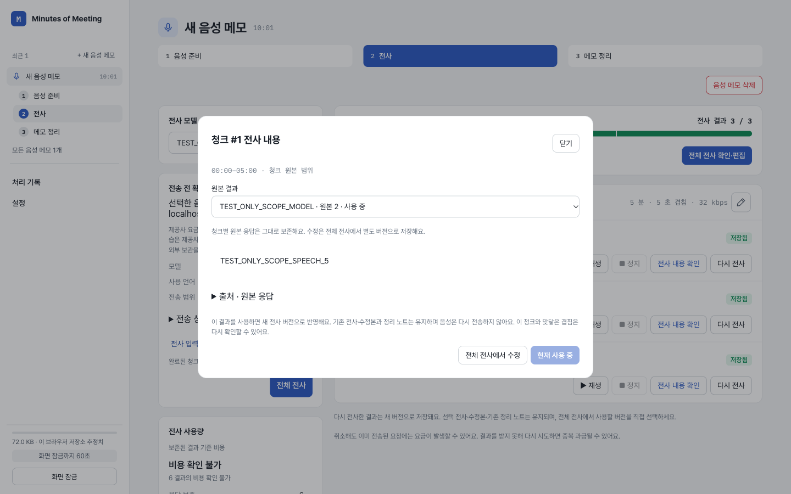

# 전사 재실행 범위와 청크 결과 확정

2026-10-19 후속 요청. 제품 커밋 `e8ec9ad`. 사용자는 성공한 청크의 재전사, 여러 결과 중 사용할 결과 확정, 전체 실행 시 완료분 건너뛰기/전체 다시 전사 선택을 요청했다. 앞선 개선의 main 배포 승인 범위에서 후속 구현·검증 후 자동 배포한다. 실제 키·고객 보관함·회의 파일·유료 추론은 사용하지 않았다.

## 원인과 변경

- 기존 UI와 queue는 저장된 청크라도 선택한 전체 전사 버전의 원본 맵에 그 청크가 없으면 재전사를 막았다. 부분 저장/이전 버전 선택 상태에서는 저장된 결과가 전체 전사본에 아직 없을 수 있다. 원본 오디오 보관·모델 호환·추가 요금 확인·검증된 저장 결과 조건을 유지하고, 현재 전사본에 포함돼야 한다는 조건만 제거했다. 모호한 원본 이력을 임의로 선택하지 않는다.
- 청크 모달의 원본 선택은 이전에는 열람만 바꿨다. 현재 사용 중인 원본을 기본 표시하고 `이 결과 사용`을 누르면 해당 결과를 반영한 별도 전사 버전을 저장·선택한다. 다른 청크의 수정 텍스트와 무관한 겹침 확인은 유지하고 변경 청크에 맞닿은 겹침은 다시 확인한다. 원본 응답·이전 전사/수정본·노트는 변경하지 않는다. 이미 선택된 결과는 중복 생성하지 않고, 원본의 저장 체크포인트·청크 연결과 선택 부모의 최신 상태를 검증한다. 새 STT/과금 요청은 보내지 않는다. 저장 실패 때는 성공 표시하지 않으며 기존의 잠금 시 미저장 완성 작업 복구 규칙을 따른다.
- 요청 이력이 있으면 왼쪽 `전체 전사`로 범위 선택 모달을 연다. 기본은 `완료된 청크 건너뛰기`이며 실패/결과 불명/미실행 청크를 함께 처리한다. 완료되지 않은 청크가 없으면 이 선택을 비활성화하고 `전체 다시 전사`만 가능하다. 매번 보낼 개수를 표시하고 범위/모델 변경 시 요금 확인을 해제한다. 모달 취소는 전송하지 않는다. 첫 전사는 기존 확인/실행 흐름을 유지한다.
- 명시적인 혼합 범위는 `transcribe-selected` 목적의 새 묶음으로 저장한다. 기존 모델 고정 재시도/초기 실행/성공 청크 재전사와 구분하고 정확한 청크/모델/프로젝트 상태에 동의를 묶는다. 실패/결과 불명의 중복 비용 고지를 유지한다. 결과 선택으로 만든 전사본은 기록된 모델을 원본들에서 표시하고 하나의 제공사/묶음으로 위장하지 않는다.

## 변경 파일

`src/react-app/App.tsx`, `controller.tsx`, `domain/types.ts`, `domain/pipeline.ts`, `transcript/batches.ts`, `ui/screens/STT.tsx`, `ui/screens/Review.tsx`, `ui/components/ChunkTranscript.tsx`와 직접 관련 테스트. 의존성·계정 정책·키·보관 설정·원본 레퍼런스 6개는 바꾸지 않았다.

## 실제 선별 검사

- `npx vitest run tests/stt-batches.spec.ts tests/stt-rerun-controller.spec.tsx tests/stt-rerun-ui.spec.tsx tests/workflow.spec.tsx`: **64 통과**. 성공 원본이 현재 전사에 없는 상태, 원본 확정/동일 시각의 다른 수정 텍스트/무관한 겹침 확인 보존, 저장 실패/잠금 복구, 오래된 부모 거절, 혼합 범위의 암호화 복원과 동의 무효화 포함.
- `npx vitest run tests/pipeline.spec.ts tests/registered-batches.spec.ts tests/transcript.spec.ts`: **64 통과**. 직접 변경한 queue·원본 계보 검증·병합/버전 의존 검사다. 위 그룹과 파일 중복이 없다.
- `npx vitest run tests/openrouter-stt-ui.spec.tsx -t 'OR_STT_review|labels saved raw provenance|projects the recorded OR requested route'`: **5 통과**, 나머지 미선택.
- `npx vitest run tests/ui.spec.tsx tests/compact-work-priority.spec.tsx -t 'retry dialog|STT retry|newer failed|STT progress|immutable raw|whole chunk speech|Korean search label|saved-chunk retranscription|labels direct OpenAI|summarizes compact usage'`: **14 통과**, 나머지 미선택.
- 변경 TS/TSX 13개에 `npx eslint`: 오류 0, 기존 App.tsx react-refresh 경고 1. `npm run build`, `npm run test:secret`, `git diff --check` 통과. 원본 6개 SHA-256은 앞선 기록과 일치한다.
- `npx playwright test --config playwright.config.ts tests/e2e/stt-scope-choice.spec.ts tests/e2e/stt-review-release.spec.ts`: 별도 headed Chrome의 프로덕션 build preview. 기존 결과 보존/모델 변경/삭제 흐름 **1 통과**(5.2초). 새 범위 흐름은 재로드 시 자동으로 편집 모달이 열릴 것이라는 잘못된 검사 기대에서 실패했다. 실제 controller는 review를 stt로 정규화하므로 검사만 수정했다.
- `npx playwright test --config playwright.config.ts tests/e2e/stt-scope-choice.spec.ts`: 수정한 실패 시나리오만 재실행해 **1 통과**(5.5초). 제품 코드는 앞서 통과한 흐름 이후 변경하지 않았다.

새 브라우저 흐름은 실제 합성 601초 WAV를 3 MP3 청크로 준비했다. 첫 전사 1개 성공·다음 요청 네트워크 실패·마지막 미실행 상태에서 `건너뛰기`는 2개만 보내 총 요청 4개가 됐다. 이후 `전체 다시 전사`는 3개를 보내 총 요청 7개가 됐다. 성공한 청크의 개별 재전사 모달 열기/취소도 가능했다. 결과 2개 중 두 번째를 사용하도록 확정하고 모바일/새로고침/잠금 해제/메모 재열기 후에도 같은 원본이 사용 중임을 확인했다. 결과 선택 자체의 추가 요청은 0이다. 모든 STT는 localhost 요청을 가로챈 명시적 TEST_ONLY 응답이며 외부 HTTPS 0·페이지 오류 0이다.

초기 새 UI 회귀 3개가 기존 코드에서 실패하는 것을 확인했다. 같은 시각의 문장 2개를 보존하는 검사도 실패를 확인한 뒤 일대일 매핑으로 고쳐 통과했다. 저장 실패 후 잠금 복구 검사는 기존 완료 작업 복구 규칙에 맞춰 기대를 수정했으며 제품의 복구 규칙을 바꾸지 않았다.

## 실제 화면

1440×900 및 390×844를 렌더링하고 시각 확인했다. 모달 범위/결과 선택은 좁은 화면에서 가로 넘침 없이 표시됐다.

[모바일 범위](390-scope.png) · [모바일 결과](390-result-choice.png)

## 한계와 배포

전체 스위트와 실제 인증 STT·청구·전사 품질은 미검증이다. 보관된 청크/검증된 결과가 없거나 모델/키/선택 계보가 유효하지 않으면 실행을 허용하지 않는다. 이미 발송된 요청의 요금은 취소로 되돌리지 않으며 결과 불명 재전송은 중복 요금이 생길 수 있다.

배포는 검증한 main의 Workers Builds 자동 배포를 사용한다. 배포 성공/활성 버전과 운영 도달·UI/자산 검증을 구분해 최종 응답에 보고하며, 로컬 합성 성공을 실제 인증 추론/전체 운영 경로 성공으로 표시하지 않는다.
