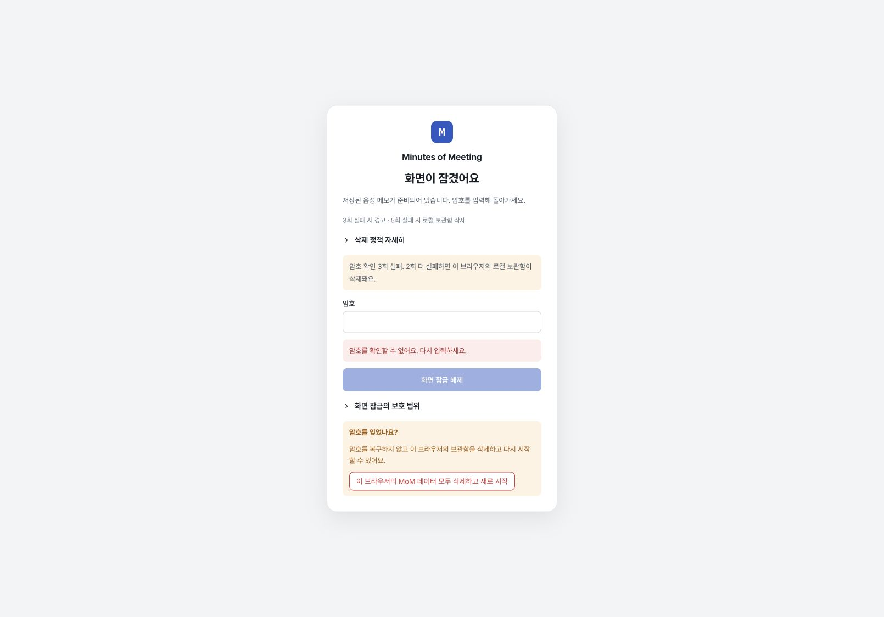
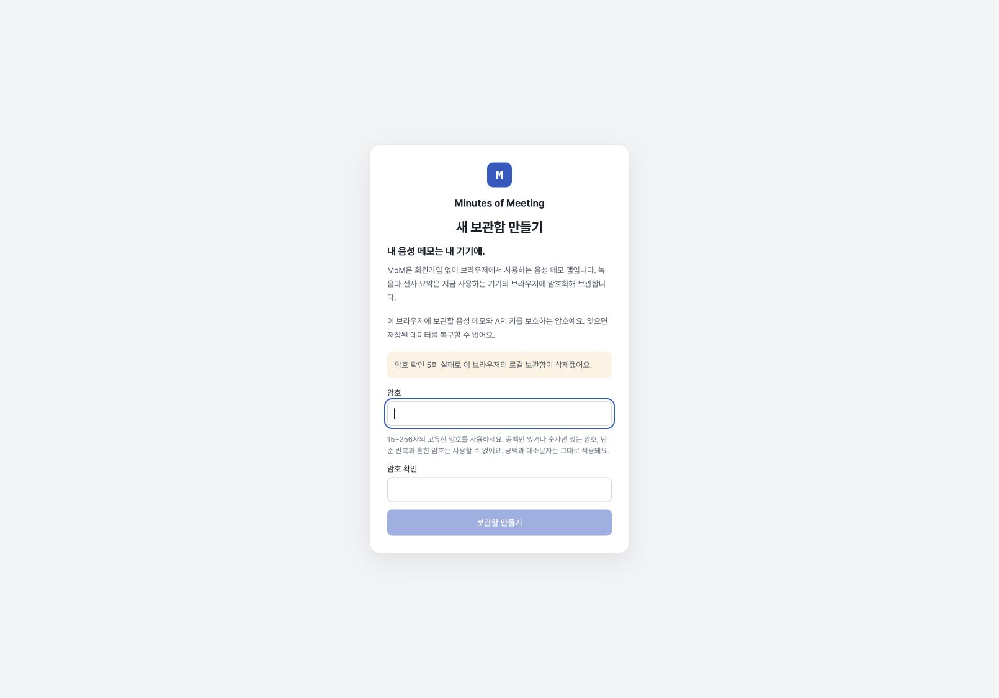

# 보관함 보안 정책과 통합 릴리스 · 2026-10-29

사용자는 보안 점검, 암호 인증 3회 실패 경고·5회 실패 시 로컬 보관함 삭제, 관련 수정의 커밋·푸시·운영 배포 확인을 요청했다. 앞선 OpenAI/OpenRouter 모델 설정·요청 기록·진행 상태 우선 UI 변경도 같은 작업 트리에서 보존해 검증한다. 실제 사용자 보관함·제공사 키·회의 원문은 검사하거나 전송하지 않았다.

## 구현과 경계

- 암호 인증 실패 횟수는 보관함에 연결하여 저장한다. 전체 잠금 해제와 화면 재인증이 공유하며, 새로고침에도 유지한다. 정상 인증은 0으로 초기화한다. 3회부터 경고, 4회에 마지막 경고, 5회에 자동 삭제한다.
- 5회 삭제 대기 상태를 먼저 저장한다. 삭제 실패 시 인증을 차단하고 삭제 재시도를 제공한다. 원래 보관함 ID와 동일 삭제 대기 상태를 같은 IndexedDB 트랜잭션에서 검사하므로, 다른 탭에서 만든 새 보관함을 이전 탭의 재시도가 지울 수 없다. 취소·저장소·소유권 오류는 암호 실패로 세지 않는다.
- 새 보관함은 15–256자 고유 암호를 요구하며 일부 흔한 값·반복·공백 전용 입력을 제한한다. 기존 보관함의 암호는 그대로 호환한다. 길이만으로 암호 강도가 보장되지는 않는다.
- AES-GCM 인증은 잘못된 암호와 정상 형태의 암호화 헤더 손상을 구별하지 못한다. 손상된 상태에서는 올바른 암호를 입력해도 실패로 집계되고 5회에 삭제될 수 있다. 이 조건과 복구 불가·오프라인 추측 한계를 접힌 정책 설명에서 확인할 수 있다.
- 실패 카운터는 앱 UI의 오입력 대응이다. 복사된 DB의 오프라인 추측이나 저장소 직접 변조·이전 사본 복원을 막는 장치가 아니다. 공개 헤더·식별자·암호문 크기 등의 기술 메타데이터는 암호화되지 않는다.
- 저장되는 키·회의 내용은 암호화되지만, 잠금 해제된 브라우저·권한 있는 확장·악성 동일 출처 코드·OS 침해에 대한 완전한 보호는 보장하지 않는다. Standard 작업 중 화면 잠금과 전체 키 해제는 다른 경계다. [보안 점검](security-audit.md), [현재 암호화 설명](../../../security-and-encryption.md)을 참고한다.

## 실제 로컬 화면

별도 Chrome 창, `http://127.0.0.1:4195/`, 1610×1124 화면에서 새 합성 보관함과 합성 메모 하나만 사용했다. 사용자 작업 주소인 4185와 운영 보관함은 열거나 수정하지 않았다.

1. 15자 이상 새 암호로 생성하고 합성 메모를 저장했다.
2. 화면 잠금 후 짧은 입력·숫자 입력을 포함한 세 번의 실패에서 경고를 확인했다.
3. 새로고침 후 3회 경고 복원, 정상 암호로 재개 후 메모 보존, 재잠금 후 실패 횟수 초기화를 확인했다.
4. 다시 3회·4회 경고와 새로고침 후 4회 유지를 확인했다. 5번째 실패에서 자동으로 새 보관함 생성 화면과 삭제 완료 안내가 나타났다. 삭제용 합성 보관함을 별도로 다시 만들지 않았다.





초기 저장소 읽기는 비동기이므로 새로고침 직후 스냅샷보다 경고의 가시 상태를 기준으로 확인했다. 4회 복원 검사 중 한 번의 locator 대기는 실제 문구의 ‘이 브라우저의’를 생략한 정확 일치 조건 때문에 실패했고, 이어 실제 화면 문구와 복원을 확인했다. 제품 실패로 해석하지 않는다.

## 공급망과 공개물

`npm audit --json --cache /private/tmp/mom-security-npm-cache`의 초기 결과는 7개 취약 의존성 항목(critical 1, high 3, moderate 3)이었다. 공개 자문은 사용하는 특수 옵션에 따라 적용 조건이 다르며, 이 숫자가 실제 앱의 동일 수 취약 경로를 뜻하지 않는다. DOMPurify 3.4.17, markdown-it 15.0.3, Cloudflare Vite 1.66.0, Wrangler 4.154.0과 허용 범위의 간접 의존성(undici 7.30.1/8.12.3, zod 4.6.7)을 갱신했다. `--ignore-scripts`로 설치했고 강제 주요 버전 변경·override는 사용하지 않았다. 재검사 결과는 **0건**이다. 배포 라이선스 원문과 고지도 새 버전과 대조해 갱신했다. 실제 인증정보가 있는 파일은 읽지 않았다.

현재 로컬 refs의 Git 이력 172개 커밋에서 `src/`, `public/`, `scripts/`, `.github/`, `package.json`, `wrangler.json`의 고유 blob을 검사했고 알려진 제공사 키·개인키 패턴에 일치한 경로는 없었다. 자격증명 파일로 분류되는 경로는 제외했다. 검사 결과는 값 없이 건수·경로만 출력한다. 알려지지 않은 형식이나 임의의 민감 텍스트를 모두 탐지하는 검사는 아니다.

## 검사·배포 결과

검사 범위는 현재 diff와 직접 연결된 제공사 옵션·요청 기록·UI·보관함·잠금·삭제 흐름이다. 전체 테스트 스위트, 실제 공급사 유료 추론, OS/브라우저 저장소 포렌식, 침투 테스트, GPU 암호 추측 비용은 범위에 포함하지 않는다.

```sh
npx vitest run --maxWorkers=2 tests/openai-models.spec.ts tests/gpt-transcribe-stream.spec.ts tests/openrouter-stt-options.spec.ts tests/openrouter-llm-options.spec.ts tests/minutes-reasoning.spec.ts tests/memo-entry.spec.ts tests/model-registrations.spec.ts tests/stt-input-settings.spec.ts tests/openrouter-stt-provider.spec.ts tests/providers.spec.ts tests/registered-runtime.spec.ts tests/registration-test.spec.ts tests/registered-comparison.spec.ts tests/minutes-budget.spec.ts tests/provider-data-policy.spec.ts
# 15파일 306개 통과

npx vitest run --maxWorkers=2 tests/passphrase-policy.spec.ts tests/vault-auth-policy.spec.ts tests/vault-auth-ui.spec.tsx tests/vault.spec.ts tests/vault-reset.spec.ts tests/vault-reset-ui.spec.tsx tests/vault-reset-controller.spec.tsx tests/screen-lock-controller.spec.tsx tests/screen-lock-races.spec.tsx tests/lock.spec.ts tests/vault-model-registrations.spec.ts tests/lock-information-density.spec.tsx
# 최초 12파일: 137개 통과, 2개 실패. 아래 해당 파일 재검사로 해결.
npx vitest run tests/lock.spec.ts tests/screen-lock-races.spec.tsx tests/vault-auth-policy.spec.ts
# 수정 후 3파일 38개 통과

npx vitest run --maxWorkers=2 tests/ui.spec.tsx tests/api-keys-ui.spec.tsx tests/model-registrations-ui.spec.tsx tests/notes-model-readiness-ui.spec.tsx tests/registered-stage-ui.spec.tsx tests/model-modalities.spec.tsx tests/stt-rerun-controller.spec.tsx tests/compact-work-priority.spec.tsx tests/history-listing.spec.tsx tests/usage-ui.spec.tsx tests/preparation-status-ui.spec.tsx tests/recording-ui.spec.tsx
# 최초 12파일: 265개 통과, 2파일 14개 실패. 아래 해당 파일 재검사로 해결.
npx vitest run tests/ui.spec.tsx tests/compact-work-priority.spec.tsx
# 수정 후 2파일 121개 통과

npx vitest run tests/output.spec.ts
# 7개 통과. 위 그룹과 중복 제거한 최종 Vitest 대상은 731개.
node --test tests/artifacts.test.mjs
# 5개 통과
npm run typecheck
npm run build
npm run test:secret
WRANGLER_LOG_PATH=/private/tmp/mom-security-wrangler.log npx wrangler deploy --dry-run
# 모두 성공. dry-run은 운영 업로드가 아님.
git diff --check
# 통과
```

암호 오류 테스트는 문자열 대신 새 `VaultAttemptError` 타입과 실제 소유권 재획득을 검사한다. 초안 복원 테스트는 `session=unlocked` 뒤 비동기 복원 중인 `screenAccess=verifying` 상태를 의도적으로 지연시켜, 입력 차단 후 최종 `open` 상태에서 저장된 초안이 복원되는지 확인한다. 나머지 14건은 파일 업로드 기본값·접힌 상세·현재 버튼 이름과 기존 제품 동작에 맞춘 테스트 갱신이며 제품 소스를 바꾸지 않았다. 진행 상태·차단 사유·전송 동의의 기본 노출, 원본·기존 결과 보존, 잠금 액션 검증은 유지했다.

변경된 앱 TS/TSX 소스 37개 경로를 `npx eslint <변경 경로들>`로 검사했다. 오류 0, 기존 코드 줄의 Fast Refresh 및 effect cleanup 경고 2개가 남는다. Node v24.11.1의 일부 jsdom 의존성 엔진 요구 미달 경고는 변경 전 잠금파일에도 존재했으며 이번에 사용한 명령은 위 결과대로 통과했다. 빌드의 기존 mixed-import·큰 번들 경고와 jsdom 오디오 메서드 미구현 경고는 남는다.

레퍼런스 원본 6개의 SHA-256은 이전 값과 동일하다. 새 보안 문서와 안내 페이지의 로컬 링크도 확인했다. 운영 revision과 실제 배포 결과는 배포 후 별도로 덧붙인다.

## 원격 미리보기 배포 수정

PR의 첫 Cloudflare 검사(`43a25a4`, build `c1bbf4e8-9736-46d0-8d24-c7102f9ac3e0`)는 원격 Node 24.22.1에서 설치·타입·앱 빌드에 성공한 뒤, 기존 비운영 명령 `npx wrangler preview`가 요구하는 `previews` 블록이 없어 실패했다. [공식 구성 문서](https://developers.cloudflare.com/workers/previews/configuration/#wrangler-configuration-file)에 따라 `wrangler.json`에 빈 `previews` 객체를 추가했다. 이 앱은 정적 자산만 배포하며 서버 데이터 바인딩이 없다.

`npm run build`를 다시 통과했고, 생성된 `dist/client/wrangler.json`에도 `previews: {}`, 기존 정적 자산 설정, `upload_source_maps: false`가 반영되는 것을 Node assert로 확인했다. 앱 동작 코드는 바뀌지 않아 위 통과한 기능 검사를 재사용한다. 이후 원격 검사와 운영 반영 결과는 별도 확인한다.

로컬 합성 테스트 도중 개발 서버의 HMR 갱신과 같은 시각에 React `flushSync` lifecycle 콘솔 경고 한 건이 있었다. 이를 오류 없는 콘솔 증거로 취급하지 않는다. 사용자 작업용 개발 서버는 유지하고, 합성 보관함을 삭제한 별도 4195 서버와 테스트 탭은 종료했다.
